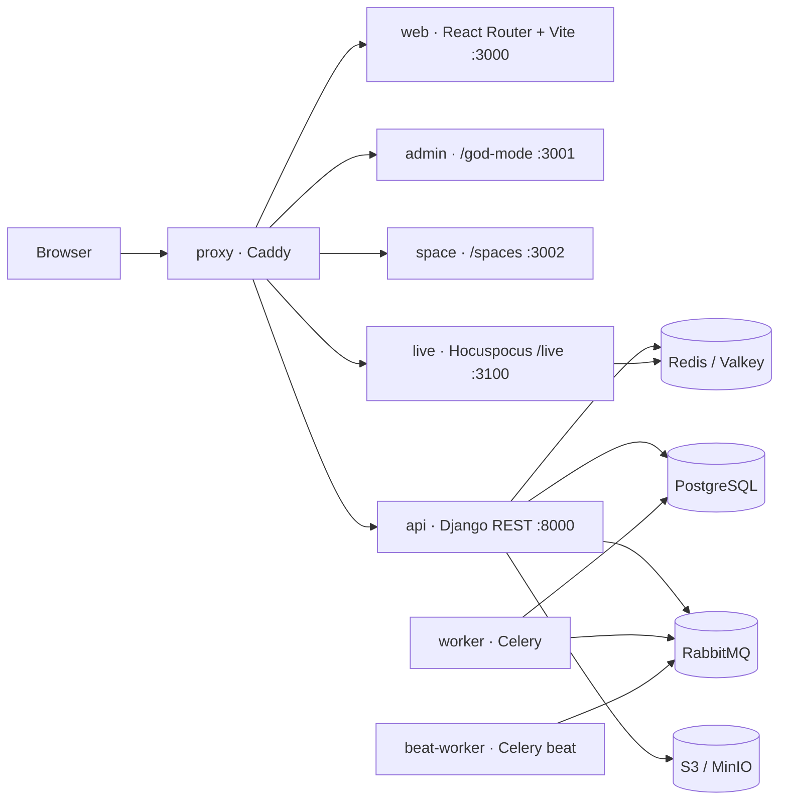

<h1 align="center">Velora</h1>
<p align="center"><b>Plan fast. Ship faster.</b></p>
<p align="center">The all-in-one work OS for high-velocity teams: projects, sprints, roadmaps and docs in one place.</p>

<p align="center">
  <a href="#-quick-start-local-development">Quick start</a> •
  <a href="#-architecture">Architecture</a> •
  <a href="#-plans-and-billing">Plans &amp; billing</a> •
  <a href="deployments/aws/README.md">Deploy on AWS</a> •
  <a href="#-troubleshooting">Troubleshooting</a>
</p>

---

## ✨ What's inside

| Area                 | Available today                                                                                  |
| -------------------- | ------------------------------------------------------------------------------------------------ |
| **Work management**  | Work items with a rich editor, sub-items, relations, labels, estimates, priorities, due dates    |
| **Agile**            | Cycles (sprints) with burn-down, modules, Kanban / list / spreadsheet / calendar / Gantt layouts |
| **Knowledge**        | Collaborative pages (real-time co-editing), wikis, stickies                                      |
| **Views & insights** | Saved filtered views, workspace analytics, dashboards                                            |
| **Intake**           | Triage queue for requests from inside and outside the team                                       |
| **Publishing**       | Public boards and roadmaps via Velora Publish (`/spaces`)                                        |
| **Billing**          | Free / Pro / Business / Enterprise plans, seat limits, Stripe Checkout and customer portal       |
| **Administration**   | Instance admin panel (`/god-mode`): sign-up policy, SSO providers, SMTP, storage                 |

**Roadmap:** epics, custom fields, custom workflows, time tracking and advanced filters (Jira-class), followed by rich table views, workload and dashboards (monday-class), then automations and approvals, then SSO/SAML, audit logs and granular permissions. Each paid feature is gated by plan, see [Plans and billing](#-plans-and-billing).

---

## 🏗 Architecture



| Path              | What it is                                                                                                | Stack                                            |
| ----------------- | --------------------------------------------------------------------------------------------------------- | ------------------------------------------------ |
| `apps/web`        | Main application                                                                                          | React 19, React Router 8, Vite 8, MobX, Tailwind |
| `apps/admin`      | Instance admin ("god mode")                                                                               | React Router, Vite                               |
| `apps/space`      | Public boards / Publish                                                                                   | React Router, Vite                               |
| `apps/live`       | Real-time collaboration server                                                                            | Node 22, Hocuspocus (Yjs), Redis                 |
| `apps/api`        | REST API, background jobs, billing                                                                        | Python 3.12, Django 5, DRF, Celery               |
| `apps/proxy`      | Single-domain reverse proxy and TLS                                                                       | Caddy                                            |
| `packages/*`      | Shared code: `types`, `constants`, `i18n` (19 languages), `editor`, `blocks` (UI), `services`, `utils`, … | TypeScript                                       |
| `deployments/aws` | Production deployment kit for AWS                                                                         | Docker Compose, ECR, RDS, ElastiCache, MQ, S3    |

The monorepo uses **pnpm workspaces + Turborepo** for JavaScript/TypeScript and **uv** for Python.

---

## 🚀 Quick start (local development)

### 1. Prerequisites

| Tool                    | Version                                | Check                    |
| ----------------------- | -------------------------------------- | ------------------------ |
| Git                     | any recent                             | `git --version`          |
| Node.js                 | **22.x** (≥ 22.22)                     | `node -v`                |
| pnpm                    | **11.10.0** (pinned in `package.json`) | `pnpm -v`                |
| Docker Desktop / Engine | 24+ with Compose v2                    | `docker compose version` |
| RAM                     | 16 GB recommended (8 GB minimum)       |                          |

Install pnpm with `corepack enable pnpm`. If that fails with a permission error (common on Windows without admin rights), use `npm install -g pnpm@11.10.0` instead.

<details>
<summary><b>Windows notes</b></summary>

- Install Node with `winget install OpenJS.NodeJS.22`, then open a new terminal.
- Use **Git Bash** (comes with Git for Windows) to run `./setup.sh`.
- Start Docker Desktop before running any `docker compose` command.
- If Docker Hub downloads fail with `EOF`, just re-run the command. Finished layers are cached and it resumes.

</details>

### 2. Clone and set up

```bash
git clone https://github.com/<your-org>/<your-repo>.git velora
cd velora
./setup.sh
```

`setup.sh` copies every `.env.example` to `.env` (root, `apps/web`, `apps/api`, `apps/space`, `apps/admin`, `apps/live`), generates a Django `SECRET_KEY` and local storage credentials, and runs `pnpm install`.

### 3. Start the backend (Docker)

```bash
docker compose -f docker-compose-local.yml up -d
```

This starts PostgreSQL, Redis, RabbitMQ, MinIO (S3-compatible storage), the Django API, the Celery worker and scheduler, and a one-off migrator. The first run builds the API image and applies all migrations, which takes a few minutes. Watch it with:

```bash
docker compose -f docker-compose-local.yml logs -f api migrator
# ready when: curl http://localhost:8000/api/instances/   → JSON
```

The API source is mounted into the container, so Python changes reload automatically.

### 4. Start the frontends

```bash
pnpm dev
```

| App                     | URL                             |
| ----------------------- | ------------------------------- |
| Velora (main app)       | http://localhost:3000           |
| Instance admin          | http://localhost:3001/god-mode/ |
| Publish (public boards) | http://localhost:3002/spaces/   |
| API                     | http://localhost:8000           |
| Real-time server        | http://localhost:3100/live      |
| MinIO console           | http://localhost:9090           |

### 5. First login

1. Open **http://localhost:3001/god-mode/** and create the instance admin account.
2. Open **http://localhost:3000**, sign up, and create your first workspace.
3. Optional: go to **Settings → Billing & plans → Developer plan switcher** to try paid plans without paying (see [Plans and billing](#-plans-and-billing)).

---

## 🧑‍💻 Everyday commands

| Task                                         | Command                                                                                                                         |
| -------------------------------------------- | ------------------------------------------------------------------------------------------------------------------------------- |
| Run every dev server                         | `pnpm dev`                                                                                                                      |
| One app only                                 | `pnpm turbo run dev --filter=web`                                                                                               |
| All checks (format, lint, types)             | `pnpm check`                                                                                                                    |
| Auto-fix format and lint                     | `pnpm fix`                                                                                                                      |
| Type-check                                   | `pnpm check:types`                                                                                                              |
| Production build                             | `pnpm build`                                                                                                                    |
| Stop backend                                 | `docker compose -f docker-compose-local.yml down`                                                                               |
| Reset backend data (⚠️ deletes the local DB) | `docker compose -f docker-compose-local.yml down -v`                                                                            |
| Django shell                                 | `docker compose -f docker-compose-local.yml exec api python manage.py shell`                                                    |
| New migration                                | `docker compose -f docker-compose-local.yml exec api python manage.py makemigrations <app>`                                     |
| Python lint                                  | `docker compose -f docker-compose-local.yml exec api ruff check .`                                                              |
| Add a Python dependency                      | `docker compose -f docker-compose-local.yml exec api uv add --no-sync <pkg>==<version>` (commit `pyproject.toml` and `uv.lock`) |
| Check translations                           | `pnpm --filter @plane/i18n run sync:check`                                                                                      |

> **uv version:** the repo pins `uv` (`required-version` in `apps/api/pyproject.toml`). If your local uv differs, run uv inside the API container as shown above.

---

## 🧪 Testing

**Backend (pytest), quick loop** inside the running dev container:

```bash
docker compose -f docker-compose-local.yml exec api python -m pytest plane/tests/unit -q
docker compose -f docker-compose-local.yml exec api python -m pytest plane/tests/contract/app/test_billing_app.py -q
```

**Backend, isolated full suite** (the same as CI, on a throwaway stack):

```bash
docker compose -f docker-compose-test.yml up --build --abort-on-container-exit --exit-code-from api-tests
docker compose -f docker-compose-test.yml down -v
```

Test conventions and fixtures are in [`apps/api/plane/tests/TESTING_GUIDE.md`](apps/api/plane/tests/TESTING_GUIDE.md).

**Frontend packages:** `pnpm --filter @plane/blocks test` (Vitest). Every new feature ships with unit tests in the package it touches.

---

## 💳 Plans and billing

Billing lives in the `plane.billing` Django app (`apps/api/plane/billing`) and the web billing store (`apps/web/store/workspace/billing.store.ts`).

| Plan           | Highlights                                                                                                         | Seats            |
| -------------- | ------------------------------------------------------------------------------------------------------------------ | ---------------- |
| **Free**       | Core work management                                                                                               | up to 12 members |
| **Pro**        | Epics, time estimates and tracking, workspace active cycles, advanced filters, dashboards, custom fields, bulk ops | purchased seats  |
| **Business**   | Pro plus workflows, approvals, automations, project templates, custom reports, teamspaces                          | purchased seats  |
| **Enterprise** | Business plus SSO, audit logs, advanced permissions                                                                | purchased seats  |

Guests are free on every plan. Pending invites count toward seats.

**Local development:** with no Stripe key, `BILLING_DEV_MODE` is on automatically. Workspace admins see a **Developer plan switcher** under _Settings → Billing & plans_ that changes plans instantly.

**Real payments:** set these in `apps/api/.env` (or production secrets), then restart the API:

```bash
STRIPE_SECRET_KEY=sk_live_...           # or sk_test_... while testing
STRIPE_WEBHOOK_SECRET=whsec_...
STRIPE_PRICE_PRO_MONTH=price_...        # plus _YEAR, and BUSINESS_/ENTERPRISE_ variants
BILLING_TRIAL_DAYS=14
```

Point a Stripe webhook at `https://<your-domain>/api/billing/webhooks/stripe/`. To test webhooks locally, use the Stripe CLI: `stripe listen --forward-to localhost:8000/api/billing/webhooks/stripe/`.

**Adding a paid feature:**

1. Add it to `Feature` in `apps/api/plane/billing/plans.py`, under the lowest plan that should include it.
2. Guard the endpoint with `@require_feature(Feature.X)`. Requests without it get `402` with the plan they need.
3. Add the key to `TBillingFeature` in `packages/types/src/billing.ts` and gate the UI with `useEntitlement("x")`.

---

## ⚙️ Configuration reference

The most important variables (see each `.env.example` for the full list):

| Variable                                           | Where                                | Purpose                                                              |
| -------------------------------------------------- | ------------------------------------ | -------------------------------------------------------------------- |
| `SECRET_KEY`                                       | `apps/api/.env`                      | Django signing key, unique per environment                           |
| `DATABASE_URL`                                     | `apps/api/.env`                      | PostgreSQL connection                                                |
| `REDIS_URL`                                        | `apps/api/.env`, `apps/live/.env`    | Cache, sessions, real-time sync (`rediss://` for TLS)                |
| `AMQP_URL` or `RABBITMQ_*`                         | `apps/api/.env`                      | Celery broker                                                        |
| `USE_MINIO`, `AWS_S3_BUCKET_NAME`, `AWS_REGION`    | `apps/api/.env`                      | File storage (MinIO locally, S3 in production)                       |
| `FILE_SIZE_LIMIT`                                  | `apps/api/.env`                      | Max upload size in bytes (default 5 MB)                              |
| `WEB_URL`, `CORS_ALLOWED_ORIGINS`, `ALLOWED_HOSTS` | `apps/api/.env`                      | Public origin and host validation                                    |
| `LIVE_SERVER_SECRET_KEY`                           | `apps/api/.env` and `apps/live/.env` | Shared secret between the API and the real-time server (must match)  |
| `STRIPE_*`, `BILLING_*`                            | `apps/api/.env`                      | Billing (see above)                                                  |
| `VITE_*_BASE_URL`                                  | `apps/web/.env`                      | Local dev only. Production images use relative URLs behind the proxy |

**Branding** (name, tagline, plan names, sales email) lives in one file: [`packages/constants/src/brand.ts`](packages/constants/src/brand.ts).

---

## ☁️ Deploying to production

**AWS (recommended):** follow **[deployments/aws/README.md](deployments/aws/README.md)**. It covers the following end to end:

- RDS PostgreSQL, ElastiCache Redis, Amazon MQ, private S3
- Images in ECR, built by `scripts/build-and-push.sh`
- An EC2 host with an IAM role (no static keys) and secrets in SSM Parameter Store
- ALB with an ACM certificate, Route 53, and CloudWatch logs and alarms
- One-command deploys and rollbacks (`scripts/deploy.sh <tag>`)
- A scaling path, a production checklist, and troubleshooting

Other targets: the community deployment kits for Docker Compose, Docker Swarm, Kubernetes and an all-in-one image are in [`deployments/`](deployments/).

---

## 🩺 Troubleshooting

| Problem                                                     | Fix                                                                                                        |
| ----------------------------------------------------------- | ---------------------------------------------------------------------------------------------------------- |
| `pnpm: command not found`                                   | Install pnpm (see Prerequisites) and open a new terminal. On Windows, add `%APPDATA%\npm` to your PATH.    |
| `corepack enable` → `EPERM`                                 | Use `npm install -g pnpm@11.10.0`.                                                                         |
| `failed to connect to the docker API`                       | Start Docker Desktop.                                                                                      |
| Docker pull fails with `EOF`                                | Network blip. Re-run the command; it resumes.                                                              |
| API logs `Waiting for database migrations…` for a long time | First boot. The migrator is still running (`docker compose -f docker-compose-local.yml logs -f migrator`). |
| `http://localhost:3000` loads but sign-in fails             | API not up yet. Check `curl http://localhost:8000/api/instances/`.                                         |
| Port already in use                                         | Stop the conflicting process, or change the port in the app's `vite.config.ts` or compose file.            |
| `uv` "required version" error                               | Run uv inside the API container (see Everyday commands).                                                   |
| Pre-commit hook killed / "command line too long" on Windows | Commit smaller batches, or stop `pnpm dev` while committing very large changes.                            |
| Need a clean slate                                          | `docker compose -f docker-compose-local.yml down -v && pnpm clean && ./setup.sh`                           |

---

## 🤝 Contributing

- Branch from `preview` using `feat/…`, `fix/…`, `chore/…` names. Use [Conventional Commits](https://www.conventionalcommits.org/) for messages.
- Run `pnpm check` (and the backend tests for API changes) before opening a PR.
- Code style, naming and package conventions are in [`AGENTS.md`](AGENTS.md). Translation rules are in [`.claude/skills/translate/SKILL.md`](.claude/skills/translate/SKILL.md).
- Report security issues privately, see [`SECURITY.md`](SECURITY.md).

---

## 📄 License and attribution

Velora is built on [Plane](https://github.com/makeplane/plane) Community Edition, © Plane Software, Inc. and contributors, and is distributed under the **GNU Affero General Public License v3.0**. See [`LICENSE.txt`](LICENSE.txt).

Under the AGPL, if you run a modified version as a network service, you must make the complete corresponding source code of your version available to its users. "Plane" is a trademark of Plane Software, Inc.; Velora is an independent product and isn't affiliated with or endorsed by Plane.
