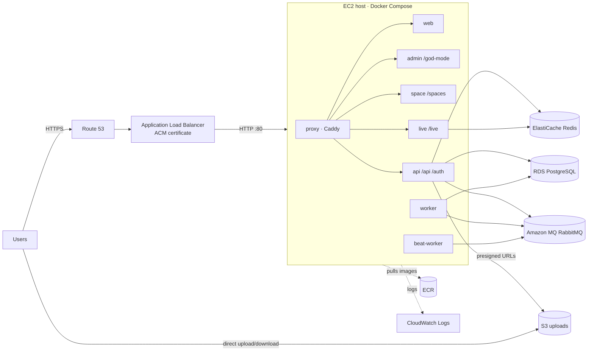

# Deploying Velora on AWS

This guide takes you from an empty AWS account to Velora running at `https://app.example.com`, with managed databases, automatic backups, TLS, central logs and zero static AWS keys on the server.

> Replace `app.example.com`, `us-east-1`, `123456789012` and `velora-prod-*` with your own domain, region, account id and names throughout.

---

## Contents

1. [Architecture](#1-architecture)
2. [Before you start](#2-before-you-start)
3. [Network and security groups](#3-network-and-security-groups)
4. [S3 bucket for uploads](#4-s3-bucket-for-uploads)
5. [PostgreSQL on RDS](#5-postgresql-on-rds)
6. [Redis on ElastiCache](#6-redis-on-elasticache)
7. [RabbitMQ on Amazon MQ](#7-rabbitmq-on-amazon-mq)
8. [Build and push images to ECR](#8-build-and-push-images-to-ecr)
9. [IAM role for the server](#9-iam-role-for-the-server)
10. [Launch the EC2 server](#10-launch-the-ec2-server)
11. [Secrets and configuration](#11-secrets-and-configuration)
12. [First deploy](#12-first-deploy)
13. [HTTPS: certificate, load balancer, DNS](#13-https-certificate-load-balancer-dns)
14. [Finish setup: admin, email, Stripe](#14-finish-setup-admin-email-stripe)
15. [Day-2 operations](#15-day-2-operations)
16. [Scaling up](#16-scaling-up)
17. [Production checklist](#17-production-checklist)
18. [Troubleshooting](#18-troubleshooting)

---

## 1. Architecture



**Why this shape**

- **App containers are stateless.** Everything that must survive (database, cache, queue, files) is a managed AWS service with its own backups and failover. The EC2 host can be replaced at any time.
- **One domain, path routing.** The Caddy proxy routes `/api`, `/auth`, `/god-mode`, `/spaces` and `/live` to the right container, so the frontend images contain no hard-coded URLs and the same image works for staging and production.
- **Files never pass through the server.** Browsers upload to and download from S3 with short-lived presigned URLs.
- **No AWS keys on disk.** The server uses an IAM instance role for S3, ECR, SSM and CloudWatch.

Approximate monthly cost in `us-east-1` with on-demand pricing (check the AWS pricing calculator for your region):

| Component                     | Starter (≈50 users)                              | Production (≈500 users, highly available)  |
| ----------------------------- | ------------------------------------------------ | ------------------------------------------ |
| EC2                           | t3.large                                         | m6i.xlarge (or 2× behind the ALB, see §16) |
| RDS PostgreSQL 15             | db.t4g.medium, single-AZ                         | db.m6g.large, Multi-AZ                     |
| ElastiCache                   | cache.t4g.small                                  | cache.m6g.large with a replica             |
| Amazon MQ                     | mq.t3.micro single instance, or bundled RabbitMQ | mq.m5.large cluster                        |
| ALB, S3, CloudWatch, Route 53 | low, usage-based                                 | usage-based                                |
| **Rough total**               | **≈ $150–250 / month**                           | **≈ $900–1,500 / month**                   |

---

## 2. Before you start

You need:

- An AWS account and an IAM user/role with admin rights for the setup.
- A domain name (Route 53 or any registrar).
- On your machine: [AWS CLI v2](https://docs.aws.amazon.com/cli/latest/userguide/getting-started-install.html) (`aws configure`), Docker with `buildx`, and git.

Pick one region and use it for everything:

```bash
export AWS_REGION=us-east-1
export AWS_ACCOUNT_ID=$(aws sts get-caller-identity --query Account --output text)
```

---

## 3. Network and security groups

Use **VPC → Create VPC → "VPC and more"** in the console:

- 2 Availability Zones, 2 public and 2 private subnets.
- 1 NAT gateway (per AZ for production).
- Name it `velora-prod`.

Create these security groups in that VPC:

| Name           | Inbound rule                              | Used by       |
| -------------- | ----------------------------------------- | ------------- |
| `velora-alb`   | TCP 80, 443 from `0.0.0.0/0` (and `::/0`) | Load balancer |
| `velora-app`   | TCP 80 from `velora-alb`                  | EC2 host      |
| `velora-db`    | TCP 5432 from `velora-app`                | RDS           |
| `velora-cache` | TCP 6379 from `velora-app`                | ElastiCache   |
| `velora-mq`    | TCP 5671 from `velora-app`                | Amazon MQ     |

Do **not** open SSH (22). You'll reach the server with **SSM Session Manager**.

---

## 4. S3 bucket for uploads

```bash
BUCKET=velora-prod-uploads
aws s3api create-bucket --bucket $BUCKET --region $AWS_REGION \
  $( [ "$AWS_REGION" != "us-east-1" ] && echo "--create-bucket-configuration LocationConstraint=$AWS_REGION" )
aws s3api put-public-access-block --bucket $BUCKET \
  --public-access-block-configuration BlockPublicAcls=true,IgnorePublicAcls=true,BlockPublicPolicy=true,RestrictPublicBuckets=true
aws s3api put-bucket-versioning --bucket $BUCKET --versioning-configuration Status=Enabled
aws s3api put-bucket-encryption --bucket $BUCKET \
  --server-side-encryption-configuration '{"Rules":[{"ApplyServerSideEncryptionByDefault":{"SSEAlgorithm":"AES256"}}]}'
# Edit s3-cors.json first: put your real domain in AllowedOrigins
aws s3api put-bucket-cors --bucket $BUCKET --cors-configuration file://deployments/aws/s3-cors.json
```

The bucket stays fully private. Velora serves files through presigned URLs.

---

## 5. PostgreSQL on RDS

Console → **RDS → Create database**:

- **Engine:** PostgreSQL 15.x.
- **Template:** Production. Choose Multi-AZ if you need high availability.
- **Instance:** `db.t4g.medium` to start.
- **Storage:** gp3, 50 GiB, with storage autoscaling on.
- **DB identifier:** `velora-prod`. **Master user:** `velora`. Generate a strong password.
- **Connectivity:** VPC `velora-prod`, private subnets, _no_ public access, security group `velora-db`.
- **Initial database name:** `velora`.
- **Backups:** 14-day retention.
- **Also enable:** deletion protection and Performance Insights.

Note the endpoint, e.g. `velora-prod.xxxxxxxx.us-east-1.rds.amazonaws.com`.

---

## 6. Redis on ElastiCache

Console → **ElastiCache → Create cache → Valkey** (or Redis OSS 7):

- **Mode:** cluster mode _disabled_. **Node:** `cache.t4g.small`. **Replicas:** 0 to start, 1 for production.
- **Subnets:** private. **Security group:** `velora-cache`.
- **Encryption in transit:** **on**. Velora connects with `rediss://`.

Note the **primary endpoint**.

---

## 7. RabbitMQ on Amazon MQ

Console → **Amazon MQ → Create broker → RabbitMQ**:

- **Deployment:** Single-instance (`mq.t3.micro`) to start, or Cluster for production.
- **Access:** private, VPC `velora-prod`, security group `velora-mq`.
- **Username:** `velora`, with a strong password.

Note the AMQPS endpoint (`amqps://b-xxxx.mq.us-east-1.amazonaws.com:5671`).

> **Budget option:** skip Amazon MQ and run the bundled RabbitMQ container instead. Set `RABBITMQ_PASSWORD` in `.env` and `AMQP_URL=amqp://velora:<password>@rabbitmq:5672/velora` in `env/api.env`. `deploy.sh` turns on the `rabbitmq` profile automatically. Queued background jobs are lost if the host is replaced, but nothing permanent is.

---

## 8. Build and push images to ECR

From the repository root, on a clean checkout of the commit you want to ship:

```bash
AWS_REGION=$AWS_REGION ./deployments/aws/scripts/build-and-push.sh
# Graviton (t4g/m7g) servers:
# AWS_REGION=$AWS_REGION PLATFORM=linux/arm64 ./deployments/aws/scripts/build-and-push.sh
```

The script:

- Creates the six ECR repositories with scan-on-push and immutable tags.
- Builds `web`, `admin`, `space`, `live`, `api` and `proxy`.
- Tags them with the git SHA and pushes them.

Note the tag it prints.

> Building the frontends needs about 8 GB of RAM. Build on your machine or in CI, not on a small server.

---

## 9. IAM role for the server

```bash
# Edit iam-instance-policy.json first if your bucket name differs
aws iam create-role --role-name velora-ec2 \
  --assume-role-policy-document '{"Version":"2012-10-17","Statement":[{"Effect":"Allow","Principal":{"Service":"ec2.amazonaws.com"},"Action":"sts:AssumeRole"}]}'
aws iam put-role-policy --role-name velora-ec2 --policy-name velora-app \
  --policy-document file://deployments/aws/iam-instance-policy.json
aws iam attach-role-policy --role-name velora-ec2 \
  --policy-arn arn:aws:iam::aws:policy/AmazonSSMManagedInstanceCore
aws iam create-instance-profile --instance-profile-name velora-ec2
aws iam add-role-to-instance-profile --instance-profile-name velora-ec2 --role-name velora-ec2
```

This grants exactly what the app needs: read/write on the uploads bucket, image pulls from ECR, reading `/velora/prod/*` secrets, writing `/velora/*` logs, and Session Manager access.

---

## 10. Launch the EC2 server

Console → **EC2 → Launch instance**:

- **AMI:** Amazon Linux 2023 (x86_64, or arm64 if you built for arm64).
- **Type:** `t3.large` (2 vCPU / 8 GiB) or larger.
- **Network:** VPC `velora-prod`, a **private** subnet, security group `velora-app`.
- **IAM instance profile:** `velora-ec2`.
- **Storage:** 40 GiB gp3, encrypted.
- **Advanced → Metadata:** IMDSv2 _required_.
- **Advanced → User data:** paste the contents of [`scripts/ec2-bootstrap.sh`](scripts/ec2-bootstrap.sh).

The bootstrap installs Docker and the Compose plugin, adds swap, and registers a `velora` systemd service so the stack restarts after a reboot.

Connect with **EC2 → Connect → Session Manager**, then:

```bash
sudo su - ec2-user
cd /opt/velora
git clone https://github.com/<your-org>/<your-repo>.git .
git checkout <the commit you built>
```

---

## 11. Secrets and configuration

Velora reads three files on the server, all git-ignored:

| File                           | Template                                       | Contains                                          |
| ------------------------------ | ---------------------------------------------- | ------------------------------------------------- |
| `deployments/aws/.env`         | [`.env.example`](.env.example)                 | ECR registry, image tag, proxy/TLS mode           |
| `deployments/aws/env/api.env`  | [`env/api.env.example`](env/api.env.example)   | Django secret, database/Redis/MQ URLs, S3, Stripe |
| `deployments/aws/env/live.env` | [`env/live.env.example`](env/live.env.example) | Real-time collaboration server settings           |

**Option A, recommended: SSM Parameter Store.** Store each variable as a SecureString, then render the files on the server:

```bash
# From your machine, once per variable
aws ssm put-parameter --type SecureString --name /velora/prod/api/SECRET_KEY \
  --value "$(python3 -c 'import secrets; print(secrets.token_urlsafe(64))')"
aws ssm put-parameter --type SecureString --name /velora/prod/api/DATABASE_URL \
  --value 'postgresql://velora:<password>@<rds-endpoint>:5432/velora?sslmode=require'
# ...repeat for every key in env/api.env.example and env/live.env.example

# On the server
cd /opt/velora/deployments/aws && ./scripts/fetch-secrets.sh /velora/prod
```

**Option B: edit the files directly.**

```bash
cd /opt/velora/deployments/aws
cp .env.example .env && cp env/api.env.example env/api.env && cp env/live.env.example env/live.env
chmod 600 .env env/*.env
vi .env env/api.env env/live.env
```

Rules that matter:

- `LIVE_SERVER_SECRET_KEY` must be **identical** in `api.env` and `live.env`.
- Do **not** write `AWS_ACCESS_KEY_ID=` or `AWS_SECRET_ACCESS_KEY=` lines, not even empty ones. Leaving them out makes the app use the instance role.
- `BILLING_DEV_MODE=0` and `DEBUG=0`. `deploy.sh` refuses to run otherwise.
- `IMAGE_TAG` is the tag printed in step 8.

---

## 12. First deploy

```bash
cd /opt/velora/deployments/aws
./scripts/deploy.sh <image-tag>
```

`deploy.sh` does the following:

1. Validates the config.
2. Logs in to ECR and pulls the images.
3. Runs database migrations.
4. Starts every service.
5. Waits for the API health check.
6. Prints the service status.

It's safe to re-run.

Quick check from the server:

```bash
curl -s -o /dev/null -w "%{http_code}\n" http://localhost/              # 200
curl -s http://localhost/api/instances/ | head -c 200                 # JSON
```

---

## 13. HTTPS: certificate, load balancer, DNS

1. **Certificate:** ACM → _Request public certificate_ for `app.example.com`, DNS validation. With Route 53, click _Create records in Route 53_.
2. **Target group:**
   - EC2 → Target groups → _Create_. Type: instances, protocol HTTP, port 80, VPC `velora-prod`.
   - Health check path: `/`. Success codes: `200-399`.
   - Register the instance.
3. **Load balancer:**
   - EC2 → Load balancers → _Application Load Balancer_. Internet-facing, public subnets, security group `velora-alb`.
   - Listener HTTPS:443 with the ACM certificate, forwarding to the target group.
   - Listener HTTP:80 that redirects to HTTPS.
   - **Attributes → Idle timeout: 3600 seconds.** Real-time collaboration uses long-lived WebSockets.
4. **DNS:** Route 53 → your hosted zone → _Create record_ `app.example.com`, type A, **Alias** to the load balancer.

Open `https://app.example.com`. It should load Velora.

> **No load balancer?** Put the instance in a public subnet with an Elastic IP and open 80/443 to the world on `velora-app`. Set `SITE_ADDRESS=app.example.com` and `CERT_EMAIL=you@example.com` in `.env`, point DNS at the Elastic IP, and re-run `deploy.sh`. Caddy fetches a Let's Encrypt certificate automatically. This is cheaper, but you lose health-checked failover and WAF.

---

## 14. Finish setup: admin, email, Stripe

1. **Instance admin:** open `https://app.example.com/god-mode/` and create the admin account. That's where you configure sign-up, SMTP email (Amazon SES works well), and Google/GitHub/GitLab login.
2. **Stripe billing:**
   - Create products and monthly/yearly prices for Pro, Business and Enterprise. Put the price ids in `STRIPE_PRICE_*`.
   - Add a webhook endpoint `https://app.example.com/api/billing/webhooks/stripe/` with these events: `checkout.session.completed`, `customer.subscription.created`, `customer.subscription.updated`, `customer.subscription.deleted`, `invoice.payment_failed`.
   - Put the signing secret in `STRIPE_WEBHOOK_SECRET` and the live secret key in `STRIPE_SECRET_KEY`.
   - Enable the **Customer portal** in Stripe settings.
   - Re-run `fetch-secrets.sh` (if you use it) and `deploy.sh`.
3. **Smoke test:** create a workspace, upload an attachment (tests S3), open a page in two browsers (tests live collaboration), and invite a teammate (tests the worker and email).

---

## 15. Day-2 operations

**Ship a new version**

```bash
# your machine / CI
AWS_REGION=$AWS_REGION ./deployments/aws/scripts/build-and-push.sh      # prints <new-tag>
# server
cd /opt/velora && git fetch && git checkout <new-commit>
cd deployments/aws && ./scripts/deploy.sh <new-tag>
```

**Roll back:** run `./scripts/deploy.sh <previous-tag>`. Tags are immutable, so the old images are still in ECR.

> Migrations normally add columns or tables, so rolling back the app is safe. If a release drops or renames columns, restore the database snapshot taken before that deploy.

**Logs:** CloudWatch → Log groups → `/velora/production`, one stream per container. From the server: `docker compose --env-file .env -f docker-compose.aws.yml logs -f api`.

**Backups**

| Data     | How it's protected                                          | Restore                                                                     |
| -------- | ----------------------------------------------------------- | --------------------------------------------------------------------------- |
| Database | RDS automated backups (14 days) plus point-in-time recovery | RDS → _Restore to point in time_ → point `DATABASE_URL` at the new instance |
| Files    | S3 versioning                                               | Restore a previous object version                                           |
| Config   | SSM Parameter Store (versioned)                             | `fetch-secrets.sh`                                                          |

Take a manual RDS snapshot before risky releases.

**Monitoring:** add CloudWatch alarms on:

- ALB `HTTPCode_Target_5XX_Count` and `UnHealthyHostCount`
- RDS `CPUUtilization`, `FreeStorageSpace` and `DatabaseConnections`
- ElastiCache `DatabaseMemoryUsagePercentage`
- EC2 `StatusCheckFailed`

Send them to an SNS topic that emails you.

**OS patching:** use SSM Patch Manager. The app containers carry their own patched base images; rebuild monthly.

---

## 16. Scaling up

Go through these in order. Each step is independent.

1. **Bigger server.** Change the instance type and raise `GUNICORN_WORKERS` (about 2× vCPUs).
2. **Bigger data tier.** Move RDS to Multi-AZ and a larger class, and add an ElastiCache replica.
3. **Two or more app servers behind the ALB.** Launch a second identical instance (or build an AMI and an Auto Scaling group) and register it in the target group. Keep these rules:
   - Run **`beat-worker` on exactly one instance**. It's the scheduler; duplicates fire jobs twice. On the others, run `docker compose ... up -d --scale beat-worker=0`.
   - Run `migrator` from one instance only. `deploy.sh` is safe to run on every host, but run it on one first.
   - Turn on ALB **stickiness** for `/live/*` (or the whole target group) so a collaboration session stays on one host.
4. **Separate worker capacity.** Run `worker` on its own instance(s) when background jobs (imports, exports, emails, automations) compete with web traffic.
5. **Containers without servers.** The same images run unchanged on **ECS Fargate**: one service per container, the ALB routing by path instead of Caddy, and Secrets Manager injecting the env files. Do this once operating EC2 hosts becomes the bottleneck.

---

## 17. Production checklist

- [ ] `DEBUG=0`, `BILLING_DEV_MODE=0`, and a unique 64+ character `SECRET_KEY`
- [ ] `ALLOWED_HOSTS`, `WEB_URL` and `CORS_ALLOWED_ORIGINS` set to your real domain
- [ ] RDS with deletion protection, 14-day backups, encryption at rest, no public access
- [ ] ElastiCache in-transit encryption on (`rediss://`); `?sslmode=require` on `DATABASE_URL`
- [ ] S3 Block Public Access on, versioning on, CORS limited to your domain
- [ ] No SSH port; access via Session Manager; IMDSv2 required
- [ ] No AWS access keys in any env file (instance role only)
- [ ] ALB idle timeout 3600 s, HTTP→HTTPS redirect, optional AWS WAF managed rules
- [ ] CloudWatch alarms routed to an SNS email
- [ ] Stripe live keys and webhook configured, and a test checkout completed
- [ ] `BRAND_SALES_EMAIL` in `packages/constants/src/brand.ts` set to a real address
- [ ] AGPL-3.0: your modified source is offered to your users (for example, a link in the app footer to your public repo)

---

## 18. Troubleshooting

| Symptom                                                 | Likely cause → fix                                                                                                                     |
| ------------------------------------------------------- | -------------------------------------------------------------------------------------------------------------------------------------- |
| ALB shows target **unhealthy**                          | Security group `velora-app` doesn't allow port 80 from `velora-alb`, or the stack isn't running (`docker compose ... ps`).             |
| `400 Bad Request` from the API                          | Missing host in `ALLOWED_HOSTS` (it must include your domain and `api,localhost,127.0.0.1`).                                           |
| `403 CSRF verification failed` on login                 | `WEB_URL` / `CORS_ALLOWED_ORIGINS` don't exactly match `https://your-domain`.                                                          |
| File upload fails with a CORS error                     | Bucket CORS `AllowedOrigins` doesn't contain your exact origin.                                                                        |
| Upload fails with `AccessDenied` / `InvalidAccessKeyId` | An empty `AWS_ACCESS_KEY_ID=` line exists in `api.env` (remove it), or the instance role is missing the S3 policy.                     |
| API logs `could not connect to server`                  | RDS security group doesn't allow 5432 from `velora-app`, or `DATABASE_URL` is wrong.                                                   |
| Background jobs (emails, invites) never run             | `AMQP_URL` is wrong (Amazon MQ needs `amqps://` and port **5671**), or `worker` isn't running.                                         |
| Pages don't sync live / collaboration disconnects       | ALB idle timeout is too low, `LIVE_SERVER_SECRET_KEY` differs between `api.env` and `live.env`, or `REDIS_URL` is wrong in `live.env`. |
| `deploy.sh` stops at the migrations step                | Read the output: `docker compose --env-file .env -f docker-compose.aws.yml --profile migrate run --rm migrator`.                       |
| Upgrade/checkout says _payments are not configured_     | `STRIPE_SECRET_KEY` is empty in `api.env`; re-deploy after setting it.                                                                 |
